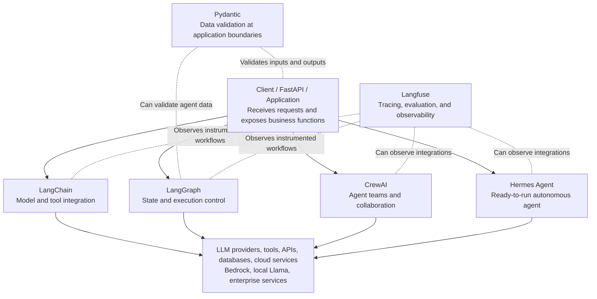

# Agentic AI Frameworks — Part 3: Architectural View

**Class Lecture 01**  
**Topic:** How agentic AI technologies fit into application architecture

## Part 3 — An Architectural View

The following is a **conceptual architecture**. It does **not** mean that every application should install all six technologies.

> **Important:** LangChain, LangGraph, CrewAI, and Hermes Agent represent **alternative or combinable approaches**, not four mandatory sequential layers. Also, LangGraph and LangChain have a close relationship: LangChain's higher-level agents use LangGraph under the hood.

### Responsibilities in the architecture

| Concern | Representative technology | Architectural question |
| --- | --- | --- |
| Validate data | Pydantic | Are inputs and outputs well formed? |
| Connect models and tools | LangChain | How does the application access models, tools, and data? |
| Coordinate stateful execution | LangGraph | What runs next, what state is preserved, and how does execution resume? |
| Run a capable autonomous assistant | Hermes Agent | What can an already-built agent do with its tools, memory, and skills? |
| Coordinate specialists | CrewAI | Which agent owns which responsibility, and how do they collaborate? |
| Observe and evaluate | Langfuse | What happened, why did it happen, and how well did it work? |

### Relating this to AWS ECS

Consider an application with **FastAPI**, a **COBOL-backed financial service**, and a **PostgreSQL** database running in containers on Amazon ECS:

1. FastAPI receives the request.
2. An agent application may use LangChain to call an LLM or retrieve relevant information.
3. LangGraph **or** CrewAI may govern a multi-step investigation, depending on the architecture.
4. Hermes Agent could instead be used as a prebuilt autonomous worker for an appropriately bounded task.
5. Pydantic validates data flowing between components.
6. Langfuse captures traces and evaluation data from instrumented components.

**Security principle:** Neither an LLM nor an orchestration framework substitutes for application authorization, IAM, policy enforcement, or human approval for dangerous changes.

### Classroom discussion

**Question:** Which components might need their own containers or services, and which might simply be Python dependencies inside an existing application container?

**Instructor direction:** Distinguish a *library*, a *framework*, a *running agent*, and an *observability service*.
