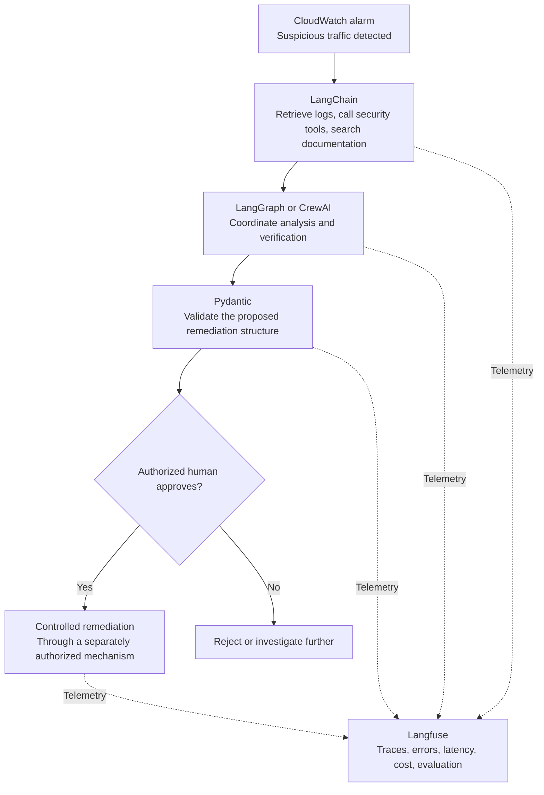

# Agentic AI Frameworks — Part 5: An AWS Security Incident

**Class Lecture 01**  
**Topic:** Applying the technologies to a realistic cloud-security workflow

## Part 5 — Example: An AWS Security Incident

Imagine students have deployed a financial application using **FastAPI**, **COBOL**, **PostgreSQL**, and **Amazon ECS**.

The application begins receiving suspicious traffic. We want AI agents to investigate the incident and recommend corrective action.

### Example investigation workflow

### Where Hermes Agent fits

Hermes Agent could serve as an **alternative autonomous investigation worker**, using its built-in tooling rather than requiring the entire agent to be implemented in LangChain or LangGraph. Assign it narrowly scoped tools and permissions suitable for the training environment.

### The role of each technology in this example

| Technology | Potential role |
| --- | --- |
| Pydantic | Validate incident findings and remediation request data. |
| LangChain | Integrate LLMs with CloudWatch logs, documentation, and approved tools. |
| LangGraph | Route the investigation through stateful analysis, verification, and approval checkpoints. |
| Hermes Agent | Act as a prebuilt, tool-using investigation worker where appropriate. |
| CrewAI | Delegate work to analyst, infrastructure, and auditing agents. |
| Langfuse | Trace and evaluate instrumented model calls and agent execution. |

> **Architecture note:** This example shows possible roles; it does **not** require simultaneous use of LangGraph, CrewAI, and Hermes Agent.

### The question to ask the class

> An AI agent detects a security vulnerability in AWS. It recommends deleting a production database because it incorrectly believes the database is compromised.
>
> **Which of these six technologies will prevent that mistake?**

**Answer: None of them automatically.**

- **Pydantic** might validate the deletion proposal as perfectly well-formed data.
- **LangGraph** might execute an entirely valid workflow.
- **CrewAI** might coordinate several agents that all arrive at the same wrong conclusion.
- **Hermes Agent** might produce an incorrect plan if its evidence or reasoning is flawed.
- **LangChain** might faithfully pass the erroneous proposal between tools and the model.
- **Langfuse** might record the entire sequence without preventing it.

Preventing damage requires properly designed **authorization boundaries**, **least-privilege IAM**, **evidence verification**, **explicit human approval**, and **policy enforcement outside the LLM**.

### Takeaway

**An LLM supplies intelligence. Frameworks organize its capabilities. Application architecture determines what it is allowed to do. Assurance establishes whether we can trust the results.**

### Suggested follow-up lecture

Compare **LangChain vs. LangGraph vs. CrewAI vs. Hermes Agent** in greater depth. That is where important architectural choices begin. Pydantic and Langfuse can remain supporting components across the different approaches.
