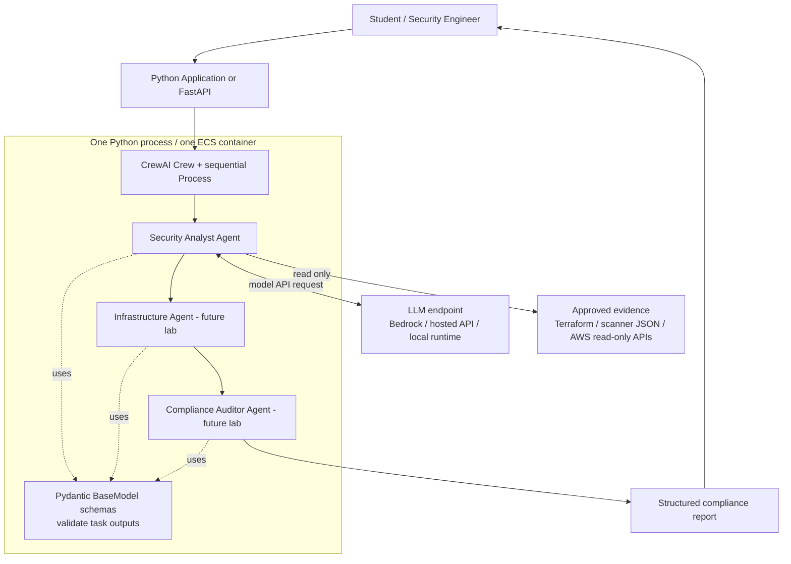
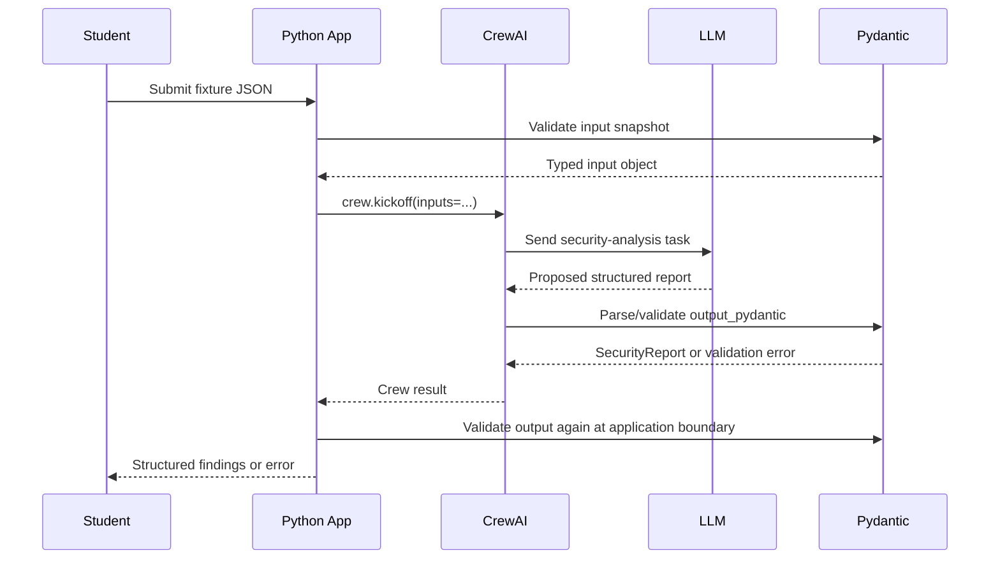

# Classroom Architecture: CrewAI + Pydantic

**Module:** Agentic AI Engineering — Introductory Architecture  
**Scope:** Read-only AWS security assessment of a Terraform change  
**Audience:** Python, Terraform, and cloud engineering students

## Learning objectives

After this module, students should be able to:

1. Explain that CrewAI and Pydantic are **Python packages**, not remote services that agents connect to.
2. Identify the difference between a **CrewAI Agent**, **Task**, **Crew**, and **Process**.
3. Describe how **Pydantic schemas** define and validate agent output.
4. Distinguish a valid **data shape** from a verified **security conclusion**.
5. Locate actual network boundaries (for example, a model provider API or AWS API).

## Scenario

A team proposes a Terraform change to an AWS environment. Three roles examine that proposal:

| Role | Responsibility | Output |
| --- | --- | --- |
| Security Analyst Agent | Identify potential vulnerabilities and risk | `SecurityReport` |
| Infrastructure Agent | Examine Terraform settings and suggest safer configurations | `TerraformAssessment` |
| Compliance Auditor Agent | Reconcile findings with control requirements; report evidence gaps | `ComplianceReport` |

The first implementation exercises **only the Security Analyst Agent**, using a provided security snapshot. Subsequent labs can add the other two roles.

## High-level architecture



> Diagram note: Arrows to Pydantic represent **local library calls**, not network connections. The LLM endpoint might itself be local or remote. The Architecture diagram is conceptual: the first lab does not deploy ECS and does not call live AWS APIs.

## Where the pieces execute

| Component | What it is | In this lab | Network connection? |
| --- | --- | --- | --- |
| `crewai` | Imported Python framework | Builds and runs an agent and task | No connection to a CrewAI server needed |
| `pydantic` | Imported Python validation library | Defines and validates the structured result | No |
| LLM | Model inference engine | Receives prompts and generates analysis | Usually an API request; depends on deployment |
| Fixture JSON | Local evidence document | Simulates security information | No |
| AWS APIs | External cloud services | **Not used** | Only in future labs with explicit calls |

**Teaching point:** `from crewai import Agent` and `from pydantic import BaseModel` load Python code. They do not connect an agent to CrewAI or Pydantic.

## Logical workflow



## Three data contracts (conceptual)

```python
from typing import Literal
from pydantic import BaseModel, Field

class SecurityFinding(BaseModel):
    resource_id: str
    severity: Literal["LOW", "MEDIUM", "HIGH", "CRITICAL"]
    explanation: str
    evidence: list[str] = Field(min_length=1)

class TerraformAssessment(BaseModel):
    file_path: str
    misconfiguration: str
    recommendation: str

class ComplianceReport(BaseModel):
    control_id: str
    status: Literal["PASS", "FAIL", "REVIEW"]
    evidence_references: list[str]
```

Each CrewAI `Task` can specify an `output_pydantic` schema. This is a **contract about format**. It does *not* independently verify whether an AWS resource is exposed, a recommendation is safe, or a regulatory control is satisfied.

## Responsibility boundaries

- **Security Analyst Agent:** recognizes risks from provided evidence; does not execute remediation.
- **Infrastructure Agent (later):** maps risk to specific Terraform configuration and proposes a patch; no `terraform apply`.
- **Auditor Agent (later):** checks evidence against explicitly supplied controls; never invents compliance certification.
- **Pydantic:** rejects incorrectly shaped data, missing fields, and invalid enumerated values.
- **Policy / human approval:** separately governs whether real changes can be executed.

## AWS deployment idea — later

A single Python service in an ECS task can host CrewAI and Pydantic. It might access Bedrock through a configured API path and read S3 objects or AWS security data through least-privilege IAM. **Three agents do not automatically require three ECS tasks.** This introductory lab operates locally and uses no AWS credentials.

## Discussion questions

1. If Pydantic accepts a `CRITICAL` finding, does that prove the finding is correct? **No.**
2. Does `Agent(...)` launch a new VM, container, or network service? **No.** It creates a Python object used by CrewAI.
3. Where is the actual model call? **At the LLM integration during crew execution.**
4. Can the agents recommend Terraform edits without permission to apply changes? **Yes.**
5. Who decides whether production infrastructure may be modified? **An external policy/authorization mechanism and, where required, a human approver.**

## Next lab

See [02_SECURITY_ANALYST_LAB.md](02_SECURITY_ANALYST_LAB.md) and [`security_analyst.py`](security_analyst.py). The lab implements the first agent with extensive comments and a structured Pydantic result.

## Reference documentation

- [CrewAI agents, crews, tasks, and processes](https://docs.crewai.com/core-concepts/Agents)
- [CrewAI documentation](https://docs.crewai.com/)
- [Pydantic documentation](https://docs.pydantic.dev/latest/)
