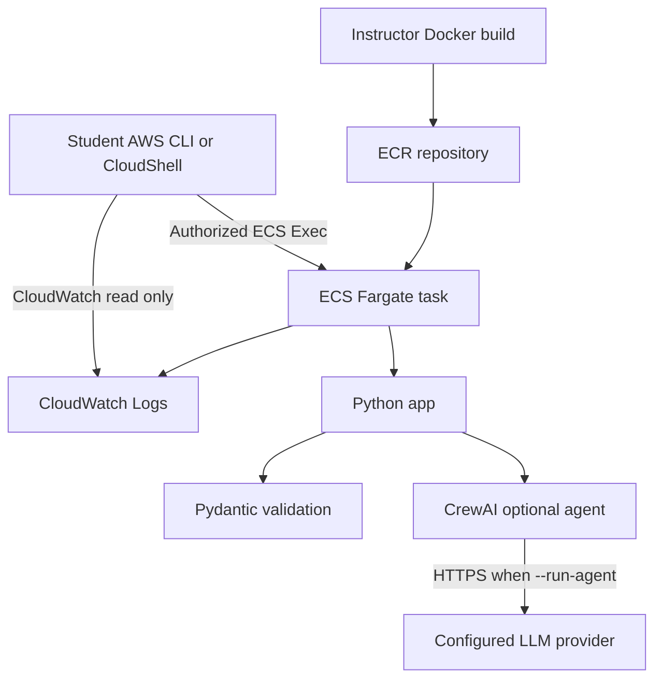

# RUNBOOK — ECS Fargate Classroom Agent Lab

> **Educational reference, not a mandatory architecture.** Establish requirements and authorization boundaries before adopting ECS, CrewAI, Pydantic, LangChain, LangGraph, Langfuse, or Hermes. This particular deployment runs the **uploaded CrewAI + Pydantic Security Analyst**, not all six technologies. It is a read-only training example, not a live AWS security scanner.

## 1. Purpose and scope

Deploy `security_analyst.py` to **Amazon ECS on AWS Fargate** as a single Python command-line container. Students can:

1. Run `--validate-only` to verify a synthetic AWS security snapshot with Pydantic **without an LLM or model-provider credentials**.
2. Optionally run `--run-agent` to use CrewAI and a configured model to analyze that same snapshot.
3. View the output through an instructor-approved ECS Exec session or run a one-off ECS task and view its CloudWatch logs.

**Important:** ECS is the container runtime, **not** a web portal. This project exposes no HTTP port and has no URL to browse. Learners connect through approved AWS identities and tools. Do not assign administrator access to every student.

### Architecture



### What is included

- `security_analyst.py` — **unchanged** from the supplied classroom code.
- `requirements.txt` — **unchanged** from the supplied dependencies (`crewai>=0.100`, `pydantic>=2,<3`). These broad ranges may resolve to different versions over time; pin tested versions before assigning the lab.
- `fixtures/security_snapshot.json` — **new synthetic fixture** matching the code's expected path. It is not an AWS-generated finding.
- `Dockerfile` — new image build recipe.
- `ecs-tasks-trust.json`, `ecs-task-role-policy.json` — instructor IAM setup references.

## 2. Prerequisites

**Instructor:** AWS account with permission to manage ECR, ECS, IAM roles, VPC networking and CloudWatch Logs; Docker with Linux containers; AWS CLI v2; a working VPC/subnets/security group; permission to use the selected model provider if demonstrating agent mode. The examples assume a POSIX-compatible shell (Bash or AWS CloudShell).

**Student:** AWS IAM Identity Center / federated role, or another individually assigned role; AWS CLI v2 and Session Manager plugin for ECS Exec (or CloudShell with working plugin); permissions scoped to the class ECS task and log group. Do not share instructor credentials.

**Networking:** Choose **one** of:

- **Teaching shortcut:** use an existing public subnet with `assignPublicIp=ENABLED`, an outbound-only security group, and VPC DNS / internet gateway routing. Do not create an inbound SSH or web rule. This is still subject to IAM and network policy; a public IP is not required for student access through ECS Exec.
- **Preferred managed environment:** private subnet and NAT or the required VPC endpoints for ECR, S3 image layers, CloudWatch Logs, Systems Manager message channels, Secrets Manager, and model access. Arrange egress for any chosen external LLM. Do not simply disable internet access and assume package/model traffic will work.

Fargate must support ECS Exec; enable Exec **when starting a new task**, and assign `ssmmessages` channel permissions to the **task role**, not only the execution role. The caller also needs `ecs:ExecuteCommand` and necessary discovery permissions. Instructor should verify access boundaries before student onboarding.

## 3. Local checkout and validation

Place all provided files under one directory, then run from that directory:

```bash
python3 -m venv .venv
. .venv/bin/activate
pip install -r requirements.txt
python security_analyst.py --validate-only
```

Expected: `Input schema valid: sg-classroom-example` followed by JSON with a HIGH-severity SSH ingress example. The result is **synthetic** and does not prove an AWS vulnerability. Pydantic is validating data types and constraints, not assessing real resources.

Build and test the image:

```bash
docker build -t ecs-agent-classroom:lab1 .
docker run --rm --entrypoint python ecs-agent-classroom:lab1 \
  security_analyst.py --validate-only
```

There is **no `-p` port mapping** because this is not a web server.

## 4. Instructor — AWS settings

Choose a region, cluster and dedicated repository. Set these variables **in the same shell** for each subsequent step:

```bash
export AWS_REGION=us-east-1
export AWS_ACCOUNT_ID=$(aws sts get-caller-identity --query Account --output text)
export CLUSTER=agent-classroom
export REPO=ecs-agent-classroom
export IMAGE_TAG=lab1
export LOG_GROUP=/ecs/agent-classroom
export TASK_FAMILY=ecs-agent-classroom
export CONTAINER=security-analyst
export ECR_URI="$AWS_ACCOUNT_ID.dkr.ecr.$AWS_REGION.amazonaws.com/$REPO"
```

Select **actual** network identifiers; don't copy nonexistent demo values:

```bash
export SUBNET_ID=subnet-REPLACE_WITH_REAL_ID
export SECURITY_GROUP_ID=sg-REPLACE_WITH_REAL_ID
```

Verify your caller and network first:

```bash
aws sts get-caller-identity
aws ec2 describe-subnets --subnet-ids "$SUBNET_ID" --region "$AWS_REGION"
aws ec2 describe-security-groups --group-ids "$SECURITY_GROUP_ID" --region "$AWS_REGION"
```

### 4.1 Create ECR, log group and ECS cluster

```bash
aws ecr create-repository --repository-name "$REPO" --region "$AWS_REGION"
aws logs create-log-group --log-group-name "$LOG_GROUP" --region "$AWS_REGION"
aws logs put-retention-policy --log-group-name "$LOG_GROUP" \
  --retention-in-days 7 --region "$AWS_REGION"
aws ecs create-cluster --cluster-name "$CLUSTER" --region "$AWS_REGION"
```

If resources already exist, inspect and reuse them; `ResourceAlreadyExistsException` is not a reason to create duplicates.

### 4.2 Build and push the image

```bash
aws ecr get-login-password --region "$AWS_REGION" | \
  docker login --username AWS --password-stdin \
  "$AWS_ACCOUNT_ID.dkr.ecr.$AWS_REGION.amazonaws.com"

docker build --platform linux/amd64 -t "$REPO:$IMAGE_TAG" .
docker tag "$REPO:$IMAGE_TAG" "$ECR_URI:$IMAGE_TAG"
docker push "$ECR_URI:$IMAGE_TAG"
```

For a real class, use an immutable version/tag or image digest instead of relying on mutable `latest`.

### 4.3 Set up two different IAM roles

**Execution role** (`ecsAgentClassroomExecutionRole`): ECS uses it to pull ECR images and deliver logs. Attach AWS-managed `service-role/AmazonECSTaskExecutionRolePolicy` and add Secrets Manager permissions **only if secrets injection is used**.

**Task role** (`ecsAgentClassroomTaskRole`): the application/runtime uses it. For this read-only fixture it **does not need** AWS resource-reading permissions. ECS Exec requires the four `ssmmessages` actions in `ecs-task-role-policy.json`. This broad `Resource: "*"` is from the ECS Exec messaging requirement; do not add unnecessary AWS privileges.

Create roles (instructor action):

```bash
aws iam create-role --role-name ecsAgentClassroomExecutionRole \
  --assume-role-policy-document file://ecs-tasks-trust.json
aws iam attach-role-policy \
  --role-name ecsAgentClassroomExecutionRole \
  --policy-arn arn:aws:iam::aws:policy/service-role/AmazonECSTaskExecutionRolePolicy

aws iam create-role --role-name ecsAgentClassroomTaskRole \
  --assume-role-policy-document file://ecs-tasks-trust.json
aws iam put-role-policy --role-name ecsAgentClassroomTaskRole \
  --policy-name ECSExecMessageChannels \
  --policy-document file://ecs-task-role-policy.json
```

> Role creation requires instructor/admin privileges. If the two roles already exist, do not blindly rerun the create commands. Use role ARNs supplied by the instructor. Organizations can require permissions boundaries and additional policy controls.

### 4.4 Register the Fargate task definition

```bash
export EXECUTION_ROLE_ARN="arn:aws:iam::$AWS_ACCOUNT_ID:role/ecsAgentClassroomExecutionRole"
export TASK_ROLE_ARN="arn:aws:iam::$AWS_ACCOUNT_ID:role/ecsAgentClassroomTaskRole"

cat > task-definition.generated.json <<EOFJSON
{
  "family": "$TASK_FAMILY",
  "requiresCompatibilities": ["FARGATE"],
  "networkMode": "awsvpc",
  "cpu": "1024",
  "memory": "2048",
  "executionRoleArn": "$EXECUTION_ROLE_ARN",
  "taskRoleArn": "$TASK_ROLE_ARN",
  "containerDefinitions": [{
    "name": "$CONTAINER",
    "image": "$ECR_URI:$IMAGE_TAG",
    "essential": true,
    "readonlyRootFilesystem": false,
    "command": ["sleep", "infinity"],
    "logConfiguration": {
      "logDriver": "awslogs",
      "options": {
        "awslogs-group": "$LOG_GROUP",
        "awslogs-region": "$AWS_REGION",
        "awslogs-stream-prefix": "ecs"
      }
    }
  ]
}
EOFJSON
aws ecs register-task-definition \
  --cli-input-json file://task-definition.generated.json \
  --region "$AWS_REGION"
```

The task defaults to `sleep infinity` so it remains running for ECS Exec. **That sleep process generates no lab output**; students must run the Python commands explicitly. No load balancer or ECS service is required for this workshop.

### 4.5 Start one interactive lab task

```bash
aws ecs run-task \
  --cluster "$CLUSTER" \
  --launch-type FARGATE \
  --task-definition "$TASK_FAMILY" \
  --enable-execute-command \
  --network-configuration "awsvpcConfiguration={subnets=[$SUBNET_ID],securityGroups=[$SECURITY_GROUP_ID],assignPublicIp=ENABLED}" \
  --count 1 --region "$AWS_REGION"
```

For **private subnet** deployment replace `assignPublicIp=ENABLED` with `DISABLED` and configure required egress/endpoints. Check the response's `failures` array. IAM role propagation may require a short delay after role creation.

Capture the running task ID and inspect it:

```bash
export TASK_ARN=$(aws ecs list-tasks --cluster "$CLUSTER" \
  --desired-status RUNNING --family "$TASK_FAMILY" \
  --region "$AWS_REGION" --query 'taskArns[0]' --output text)
aws ecs describe-tasks --cluster "$CLUSTER" --tasks "$TASK_ARN" \
  --region "$AWS_REGION" \
  --query 'tasks[0].{state:lastStatus,exec:enableExecuteCommand,containers:containers[*].{name:name,state:lastStatus}}'
```

If multiple students share a cluster, do **not** rely on the first list result: instructors must provide the exact assigned task ARN to each student. Wait until the task reaches RUNNING before executing commands.

## 5. Student — how to access the lab

### Access method A — ECS Exec (interactive, instructor-approved)

The instructor provides: `AWS_REGION`, `CLUSTER`, **your assigned** `TASK_ARN`, the container name `security-analyst`, and a student role with `ecs:ExecuteCommand` scoped to your task/container and `ecs:DescribeTasks` as needed.

1. Sign in through the organization's approved AWS Identity Center portal, or use your assigned AWS CLI profile.
2. Open a terminal with AWS CLI v2 and Session Manager plugin; CloudShell may be used if those prerequisites are verified.
3. Check your identity with `aws sts get-caller-identity`.
4. Run:

```bash
aws ecs execute-command \
  --region "$AWS_REGION" \
  --cluster "$CLUSTER" \
  --task "$TASK_ARN" \
  --container security-analyst \
  --interactive \
  --command "/bin/sh"
```

Inside the container:

```bash
cd /app
ls -l
python security_analyst.py --validate-only
exit
```

**What did not happen?** You did not SSH to an EC2 host and did not visit a web URL. ECS Exec connected an authorized user to a process inside the Fargate container using the AWS-managed Systems Manager channel. Python then imported Pydantic locally.

**Security warning:** ECS Exec gives shell-level access within the container; it is not an ideal least-privilege interface for a large untrusted class. Assign separate tasks or identities and avoid sensitive mounted data. CloudWatch logs are the preferable default for most observers.

### Access method B — Instructor-run one-off task + CloudWatch logs (recommended for broad classes)

For students who should **not** get an interactive container shell, the instructor runs a fresh one-off task with a command override. It executes and exits, making output accessible through CloudWatch Logs.

```bash
aws ecs run-task \
  --cluster "$CLUSTER" \
  --launch-type FARGATE \
  --task-definition "$TASK_FAMILY" \
  --network-configuration "awsvpcConfiguration={subnets=[$SUBNET_ID],securityGroups=[$SECURITY_GROUP_ID],assignPublicIp=ENABLED}" \
  --overrides '{"containerOverrides":[{"name":"security-analyst","command":["python","security_analyst.py","--validate-only"]}]}' \
  --count 1 --region "$AWS_REGION"
```

**Student console instructions:** AWS Console → CloudWatch → Log groups → `/ecs/agent-classroom` → choose the assigned task's log stream (`ecs/security-analyst/<task-id>`) → read `Input schema valid` and the JSON result. Use read-only logs access, scoped to that log group. Students can also inspect task status using ECS console read-only permissions.

**Student CLI option:**

```bash
aws logs tail /ecs/agent-classroom --region "$AWS_REGION" --since 1h
```

This tails the class log group, possibly including **other students' logs**. Use a unique log group per student/group, a known stream name, or an instructor-provided per-task view if privacy matters. Never put credentials or sensitive evidence in the logs.

### Access method C — optional browser interface (future exercise)

This project has **no FastAPI HTTP endpoint**. Adding ALB, authentication, private networking, and an API/UI would be a **separate design exercise**, not a prerequisite to using Pydantic or CrewAI. Do not open a public container port solely to make this sample reachable from a browser.

## 6. Optional live CrewAI model run

The uploaded script defaults to `MODEL_NAME=openai/gpt-4.1-mini` and requires a compatible model-provider key when `--run-agent` is used. The lab's read-only evidence does **not** require AWS API credentials.

**Instructor configuration:** Store the provider key in AWS Secrets Manager; grant the execution role narrowly scoped `secretsmanager:GetSecretValue` (and KMS decrypt permissions only if needed); add an ECS task-definition `secrets` entry mapping `OPENAI_API_KEY` to the secret ARN; then register a new task definition revision and launch a new task. **Never** put the key in source control, a CLI override JSON string, Dockerfile `ENV`, or plain-text task-definition environment values. Ensure egress to the provider. Configure the model identifier per the selected CrewAI release.

After a new task launches with properly injected credentials, an authorized student can use ECS Exec:

```bash
python security_analyst.py --run-agent
```

Alternatively, the instructor runs a one-off task with command override `python security_analyst.py --run-agent` and students inspect CloudWatch logs. This incurs model/API charges; treat all outputs as **unverified AI analysis**. The sample prevents direct AWS modification by not exposing Boto3 or mutation tools. The LLM can still produce inaccurate recommendations.

### Alternative inference provider

Amazon Bedrock can be explored as a separate assignment after students verify the provider identifier, IAM permissions and network path for the CrewAI/LiteLLM version they install. Do not assume `MODEL_NAME` alone automatically configures Bedrock access.

## 7. Common failures and what to check

| Symptom | Likely cause | Check |
|---|---|---|
| `FileNotFoundError: fixtures/security_snapshot.json` | Fixture absent from container | Confirm `COPY fixtures/ ./fixtures/` and `/app/fixtures/security_snapshot.json` |
| `No module named crewai` | Image built before dependency installation | Rebuild, push a new version, register a new task revision |
| Validation fails | Fixture changed or violates `InboundRule`/`SecuritySnapshot` schema | Compare JSON with Pydantic model definitions |
| `CannotPullContainerError` | ECR auth, execution IAM role, architecture, or network | Check task `stoppedReason`, execution role and ECR connectivity |
| `ResourceInitializationError` | Network cannot reach ECR/Logs or secrets | Confirm subnet routes/NAT/VPC endpoints and permissions |
| ECS Exec `TargetNotConnectedException` | Task missing Exec enablement, `ssmmessages` task permissions or channel connectivity | Check `enableExecuteCommand`, role policy, subnet endpoints, ECS Exec agent status |
| ECS Exec access denied | Student role lacks scoped `ecs:ExecuteCommand` | Ask instructor; **do not** grant AdministratorAccess |
| Blank CloudWatch stream | Container is running `sleep infinity` | Run Python through ECS Exec or launch the one-off override task |
| `OPENAI_API_KEY` missing | Instructor did not inject secret | Check new task-definition revision and execution-role secret access |
| Model request fails | Incorrect provider, endpoint, credential, rate limit, or network egress | Check model selection and sanitized logs; avoid printing tokens |
| Unexpected costs | Unstopped Fargate task / LLM calls / CloudWatch usage | Stop tasks after exercise, monitor AWS Budgets |

## 8. Stop and clean up

**Instructor:** Stop **only** the lab tasks you created, using exact task IDs. Fargate continues to bill while `sleep infinity` tasks are running.

```bash
aws ecs stop-task --cluster "$CLUSTER" --task "$TASK_ARN" \
  --reason "End of classroom exercise" --region "$AWS_REGION"
```

After confirming no other group uses the resources, optionally deregister task-definition revisions and delete the lab cluster, ECR repository/images, and log group. IAM role removal must first detach the execution policy and delete the inline task policy. Do not delete a shared VPC, subnet, or security group. Remove any temporary secrets separately if no longer required.

## 9. Learning checkpoints

Ask students to record the exact location and type of each boundary:

1. Where does `from pydantic import BaseModel` execute? **Inside Python in the container.**
2. Does `--validate-only` contact an LLM? **No.**
3. What does ECS manage? **Container/task lifecycle.**
4. What executes when `crew.kickoff()` runs? **The configured CrewAI tasks, potentially including remote model API calls.**
5. What is the difference between `executionRoleArn` and `taskRoleArn`? **Infrastructure bootstrap/logging versus permissions assumed by the running task.**
6. Why is ECS Exec not the default access for all students? **It grants interactive container access, which must be tightly controlled.**
7. Does successful Pydantic validation prove the vulnerability exists? **No; only schema validity is established.**

**Suggested follow-up (not required):** add an Infrastructure Agent, LangGraph routing, Langfuse telemetry, or an independently deployed Hermes Agent only after writing functional requirements, threat boundaries, cost limits, and deployment/access requirements. None of those frameworks is required to run this starter lab.

## 10. AWS reference links

- [ECS getting started](https://docs.aws.amazon.com/AmazonECS/latest/developerguide/getting-started.html)
- [ECS Exec guide](https://docs.aws.amazon.com/AmazonECS/latest/developerguide/ecs-exec-run.html)
- [ECS task IAM roles and ECS Exec permissions](https://docs.aws.amazon.com/AmazonECS/latest/developerguide/task-iam-roles.html)
- [ECS Fargate task-definition examples](https://docs.aws.amazon.com/AmazonECS/latest/developerguide/example_task_definitions.html)
